# Simple RPC Handler Design

**Status:** Steps 1–8 completed: protocol, all four handlers, bounded concurrent TCP server, shutdown, multiplexed client, and optional retries. Open-loop load generation is implemented; formal performance measurements remain pending.  
**Language:** Go  
**Assignment:** [Tufts CS151 Simple RPC Handler](https://www.cs.tufts.edu/comp/151FDS/pages/assignments.html)

## Purpose and scope

The system separates a caller from the machine performing computation. It provides four remote operations, synchronous and asynchronous client APIs, and an open-loop benchmark that measures behavior under increasing load. The assignment also requires testing, protocol documentation, and performance analysis. The architecture below describes proposed implementation choices.

The initial deployment is one server with multiple clients on a trusted local network. Authentication, encryption, service discovery, and distributed execution across multiple servers are outside this design's scope.

## Architecture

```mermaid
flowchart LR
    App[Application] --> API[Client API: Call / CallAsync]
    Load[Open-loop load generator] --> API
    API --> Pending[Request IDs and pending calls]
    Pending --> Writer[Serialized connection writer]
    Writer -->|Framed JSON over TCP| Reader[Server connection reader]
    Reader --> Validate[Validate and resolve method]
    Validate --> Queue[Bounded shared work queue]
    Queue --> Workers[Fixed worker pool]
    Workers --> Ops[Operation handlers]
    Ops --> Reply[Serialized response writer]
    Reply -->|Response with request ID| Dispatch[Client response reader]
    Dispatch --> Pending
    Pending --> Results[Caller result / benchmark record]
    Results --> CSV[CSV measurements and plots]
```



Each client connection has one response reader, a protected pending-call map, and serialized writes. Each server connection has one request reader and serialized response writes. A shared, bounded queue feeds a configurable number of workers across all connections. Workers run handlers and write responses; write deadlines prevent an unresponsive client from occupying workers indefinitely. Responses may complete out of order.

Proposed code layout:

```text
cmd/server/           Server entry point and configuration
cmd/loadgen/          Arrival scheduling and benchmark reporting
client/              Public client API and connection management
internal/protocol/   Message types, framing, and validation
internal/operations/ Pure computation handlers
internal/server/     Registry, connections, queue, and workers
results/             Raw measurements and generated plots
docs/                Performance report and usage examples
```

## Wire protocol and operation contracts

Use persistent TCP connections. Each frame starts with a four-byte unsigned big-endian JSON payload length. Receivers read the header and payload fully, handling partial reads and coalesced TCP packets. The initial maximum payload is 16 MiB, configurable consistently on both sides; a receiver rejects an oversized length before allocating the payload.

Every request carries a connection-unique string ID, a method, and operation-specific parameters. Responses echo the ID and contain exactly one of `result` or `error`.

```json
{"id":"42","method":"sort_array","params":{"values":[3,1,2]}}
{"id":"42","result":{"values":[1,2,3]}}
{"id":"43","error":{"code":"INVALID_ARGUMENT","message":"dimension must be positive"}}
```

The following schemas implement the assignment's [operation contracts](https://www.cs.tufts.edu/comp/151FDS/pages/assignments.html):

| Method | Parameters | Result |
| --- | --- | --- |
| `hash_compute` | `data`: base64 bytes | `hex`: 64-character lowercase SHA-256 digest |
| `sort_array` | `values`: signed int32 integers | `values`: ascending integers; stability is not promised |
| `matrix_multiply` | `n`: positive integer; `a`, `b`: flat row-major float64 arrays of length `n*n` | `n`, `values`: row-major product |
| `compress_data` | `algorithm`: `zlib` or `lz4`; `data`: base64 bytes | `algorithm`, `data`: base64 compressed bytes |

Use standard zlib streams and the LZ4 frame format, with one pinned Go LZ4 dependency. Empty byte inputs and empty sort arrays are valid. Decode operation parameters into typed structures to reject fractional or out-of-range integers. Validate matrix sizes with overflow-safe arithmetic before allocation; apply configurable operation-size limits as well as the frame limit. Non-finite matrix inputs or results return `INVALID_ARGUMENT` or `NUMERIC_ERROR`, respectively, because JSON cannot represent them.

## Execution, failures, and resource limits

The server registry maps method names to validation and execution handlers. Valid work enters the shared queue without blocking; a full queue returns `OVERLOADED`. Unknown methods return `METHOD_NOT_FOUND`. Additional codes include `INVALID_REQUEST`, `RESOURCE_EXHAUSTED`, and `INTERNAL_ERROR`. Errors expose useful explanations without internal stack traces.

If framing is invalid, JSON cannot be decoded, or no trustworthy request ID exists, close the connection. Otherwise, return a structured error and continue serving it. Configure connection limits, read/write deadlines, queue capacity, worker count, and per-operation input limits to bound resource consumption. Release a worker even when response delivery fails.

The client exposes:

```go
func (c *Client) Call(ctx context.Context, method string, params any, result any) error
func (c *Client) CallAsync(ctx context.Context, method string, params any) <-chan Response
```

`Response` holds a raw JSON result or an error. `Call` waits on the asynchronous machinery and decodes the result. Register pending calls before writing requests. Each asynchronous call receives a buffered channel with one terminal response, followed by closure. Resolve completion, cancellation, and connection failure atomically so a call completes only once. On cancellation, remove its pending entry; ignore any late response. Cancellation does not interrupt server computation in this version.

On connection loss, fail every pending call promptly. Optional retries use capped exponential backoff with jitter, at most two retries, and the caller's original deadline. Retry transient transport failures only; validation and overload errors return directly. A retry uses a new request ID. Execution may occur more than once if a response was lost, which is acceptable for these side-effect-free handlers. There is no exactly-once guarantee or server deduplication. Benchmarks disable retries.

Shutdown stops accepting connections and admitting requests, drains accepted work within a deadline, then closes connections. Log request IDs, methods, durations, and error codes; avoid payload logging and disable verbose per-request logging during measurement.

## Open-loop measurement

Schedule request arrivals from a monotonic start time using `start + i/rate`, independently of completions. Pre-generate deterministic inputs so workload preparation does not dominate dispatch. Configure offered rate, duration, payload sizes, operation mix, connection count, and maximum in-flight requests.

Record scheduled arrival, send start, response completion, method, and outcome for each attempt. Primary latency is response completion minus send start, including client serialization and transport. Also report scheduling delay and scheduled-arrival-to-completion time. If the in-flight cap is reached, record a missed dispatch instead of waiting. Record late dispatches explicitly so generator saturation cannot silently convert the experiment to closed-loop behavior.

After warm-up, run repeated rate sweeps for each operation and a fixed mixed workload. Stop arrivals at the measurement deadline and allow a bounded drain period. Associate latency samples with requests sent during the measurement window; report incomplete requests separately. Export raw CSV and summaries containing offered and dispatched rates, successful completions per measurement second, error/miss counts, mean latency, and p50/p95/p99 latency for successful requests.

Plot mean and p95 latency against offered rate, plus throughput and failure rates. Define sustainable throughput against a stated latency/error threshold before interpreting results. Record hardware, process placement, runtime version, worker count, and input sizes. When client and server share a machine, account for competition for CPU and monitor scheduling delay to identify generator bottlenecks.

## Validation and trade-offs

Unit tests cover known operation outputs, compression round trips, malformed parameters, frame boundaries, partial I/O, and oversized frames. Integration tests cover concurrent clients, out-of-order responses, deadlines, disconnects, overload, and shutdown. Run `go test ./...` and `go test -race ./...`; use a deliberately slow handler to verify that load-generator arrivals remain independent of response completion.

JSON simplifies inspection and documentation but adds encoding cost and base64 expansion. TCP supplies reliable ordered bytes while request IDs allow out-of-order operation completion. A bounded worker pool makes overload visible and controls CPU contention, though a shared FIFO queue allows expensive matrix calls to delay short requests. Begin with this architecture and measure those effects before considering binary encoding, separate operation queues, or optimized kernels. The performance report will contain measured results rather than assumed capacity claims.
